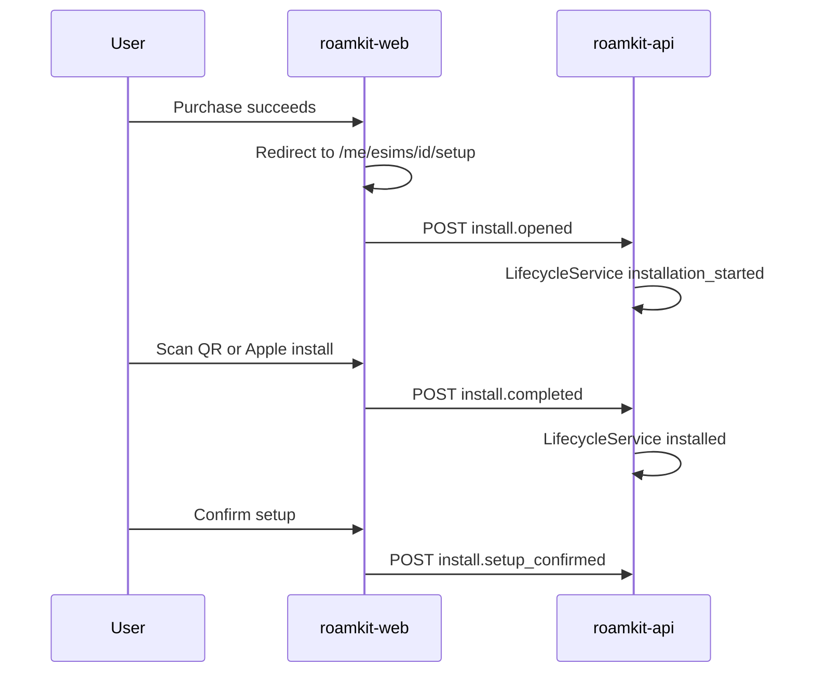
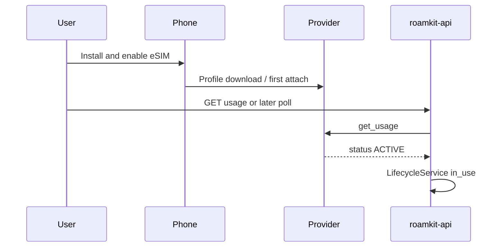
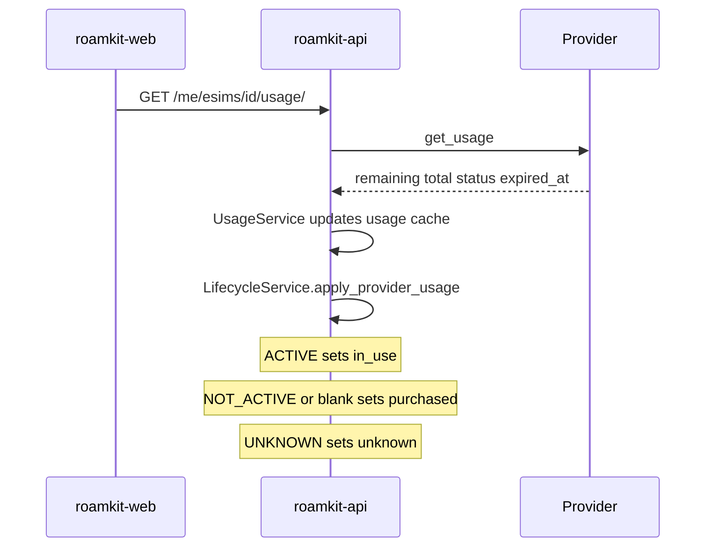

# ADR 014: eSIM lifecycle and install telemetry

| Field | Value |
|-------|-------|
| Status | Accepted |
| Date | 2026-07 |
| Amended | **2026-08-14 (reactivate `exhausted`/`expired` on explicit provider `ACTIVE`)**; **2026-10-11 (overwrite `Esim.status` from the current usage payload; add admin and periodic refresh entry points)** |
| Deciders | Faza 5 Wave 1 design freeze |

## Context

Faza 2 shipped purchase, QR/install payload, on-demand usage, and top-up. Post-purchase UX still dumps users on a raw eSIM detail page. `Esim.status` stays `unused` after provision and is not advanced. There is no install funnel telemetry, no purchase-time activation-policy snapshot, and no sole mutator for product lifecycle state.

Without locked lifecycle rules, status writes will sprawl across views and commands (same failure mode ADR 010 avoided for money via `CreditService`).

## Decision

Adopt a **guided post-purchase setup**, a **guarded `Esim.status` state machine** owned only by `LifecycleService`, an **append-only `EsimLifecycleEvent`** trail for install telemetry, and an **activation-policy snapshot on `Esim`** at fulfillment.

### Product state

Expand `Esim.status` (no parallel `lifecycle_status`). Values:

`purchased`, `installation_started`, `installed`, `activated`, `in_use`, `exhausted`, `expired`, `unknown`.

Migration: existing `unused` → `purchased` via Django `RunPython` only (no ops backfill script).

### State machine

Allowed transitions:

```text
purchased → installation_started → installed → activated → in_use
                                                      ↘ exhausted
                                                      ↘ expired
in_use → exhausted | expired
exhausted → expired
exhausted → activated | in_use
expired → activated | in_use
purchased → installed   (wizard may skip intermediate telemetry)
```

`transition()` forbids install-funnel reverse transitions (e.g. `expired → installed`, `expired → purchased`, `in_use → purchased`). Those reverses are not client-event edges.

Provider usage does not walk this graph. The 2026-10-11 amend overwrites `Esim.status` from the current usage payload, including moves back to `purchased` or `unknown`. That overwrite is not a `transition()` edge.

### Reactivation after top-up (2026-08-14 amend)

A fulfilled top-up (manual or auto) can restore provider data after `exhausted` or `expired`. Sticky terminal `Esim.status` must not hide an active provider plan.

**Sole entry:** only `LifecycleService.apply_provider_usage()` may reactivate, and only when the **current** provider usage payload has `status` equal to `ACTIVE` (trim + case-normalize). As of the 2026-10-11 amend the target is always `in_use`. The earlier split (consumption → `in_use`, otherwise `activated`) is retired.

**Must not** reactivate from:

- cached `Esim.usage_status` / `usage_remaining_mb` / `usage_expired_at` / `usage_synced_at`
- a `Topup` row (`fulfilled` or otherwise)
- the assumption that a purchase or auto-top-up succeeded

Provider `EXPIRED` or `FINISHED` must not reactivate. Repeated identical `ACTIVE` syncs are idempotent (no status change, no extra lifecycle event).

This amend does **not** change [ADR 010](./010-polygon-usdt-prepaid-credits.md). Implementation must not touch billing, ledger, refund, or re-run top-up fulfillment. Reactivation runs on the next normal usage sync (`GET /me/esims/{id}/usage/` or beat). Post-fulfillment usage refresh is **out of scope** for the API PR that implements this amend.

Implementation of each amend is a **separate API PR** after the docs amend merges. Do not implement API, web, or production smoke in the docs PR.

**Sole mutator:** only `LifecycleService` may write `Esim.status`. Architecture test enforces this (same pattern as ADR 010 / `CreditService`).

| Status | Who drives |
|--------|------------|
| `purchased` | Fulfillment (`create_purchased`), or a usage pull whose provider status is `NOT_ACTIVE`, blank, or null |
| `installation_started` / `installed` | Client-attested events → `LifecycleService` |
| `activated` | Client/provider path only via `transition()`; usage pulls no longer target `activated` |
| `in_use` | Usage pull with provider `ACTIVE` |
| `exhausted` | Usage pull with provider `FINISHED` |
| `expired` | Usage pull with provider `EXPIRED` |
| `unknown` | Usage pull with provider `UNKNOWN` |

### Usage status overwrite (2026-10-11 amend)

On every successful usage fetch, `UsageService.get_usage` refreshes the usage cache and then `LifecycleService.apply_provider_usage` overwrites `Esim.status` from that payload. All callers must use that service; they must not write usage cache fields or `Esim.status` directly.

Allowed live-sync entry points are:

- `GET /me/esims/{id}/usage/`
- auto-topup usage refresh
- a CSRF-protected admin POST for one eSIM, requiring `esims.change_esim`
- a Celery beat every 300 seconds for stale eSIMs whose local status is
  `in_use`, `purchased`, or `unknown`

Opening an admin change page remains read-only and does not call the provider.
The periodic task skips rows refreshed within the previous 300 seconds, processes
eligible eSIMs sequentially, and isolates provider failures per eSIM. A disabled
Airalo integration performs no periodic provider calls. `archived_at` is not a
filter: local presentation metadata must not gate usage refresh.

Compare provider `status` after trim and case-normalize:

- `ACTIVE` → `in_use` (including zero consumption)
- `FINISHED` → `exhausted`
- `EXPIRED` → `expired`
- `NOT_ACTIVE` → `purchased`
- `UNKNOWN` → `unknown`
- empty string or null → `purchased`, and `Esim.usage_status` stays blank
- any other string → store it on `Esim.usage_status`; do not change `Esim.status`

If the mapped target equals the current status, write nothing and append no lifecycle event.

The overwrite may move backwards (`in_use` → `purchased`, any status → `unknown`). `transition()` still rejects those edges. Client install events stay forward-only. A later `NOT_ACTIVE` or blank usage pull can reset install progress to `purchased`.

Do not change `Esim.status` from cached `usage_*` fields, a `Topup` row, or the assumption that a purchase or top-up succeeded. Billing, ledger, refund, and fulfillment stay out of this path.

### Setup session fields on `Esim`

| Field | Purpose |
|-------|---------|
| `setup_version` | Wizard version at last open/complete |
| `setup_resume_step` | 1–4 resume position |
| `setup_completed_at` | Wizard finished |
| `setup_skipped_at` | User dismissed setup |

### Activation policy

- `Package.activation_policy` — synced from Airalo for catalog (`first_usage` \| `installation` \| `unknown`).
- `Esim.activation_policy` — **copied at fulfillment** from the package. Wizard/support always read the eSIM snapshot, never the live catalog row.

### `EsimLifecycleEvent` (append-only)

| Field | Notes |
|-------|--------|
| `id` | UUID PK |
| `esim`, `user` | FKs |
| `event_type` | Namespaced string |
| `source` | `client` \| `system` \| `provider` |
| `schema_version` | Payload contract version (start at `1`) |
| `idempotency_key` | Unique per eSIM; retries return existing row |
| `setup_session_id` | Correlates one onboarding run |
| `payload` | JSON |
| `user_agent` | Optional |
| `created_at` | Immutable |

Never update or delete event rows.

### Event taxonomy

Wave 1 implements `install.*` plus minimal `provider.*` / `system.*`. Reserved for later: `usage.*`, `topup.*`, `support.*`, `notification.*`.

Client allowlist (Wave 1): `install.opened`, `install.qr_rendered`, `install.qr_zoomed`, `install.apple_install_clicked`, `install.manual_install_clicked`, `install.completed`, `install.roaming_checklist_viewed`, `install.setup_confirmed`, `install.setup_skipped`.

### API

- `POST /api/v1/me/esims/{id}/events/` — JWT + ownership; idempotent via `idempotency_key`.
- `GET /api/v1/me/esims/{id}/events/` — chronological trail for owned eSIM.
- Cross-user access matches list/detail (`404`). Never accept body `user_id` / foreign `esim_id` to override path ownership.

Additive fields and new endpoints do not bump `/api/v1`. Renaming status `unused` → `purchased` is a **coordinated v1 sole-consumer exception** (OpenAPI changelog + `roamkit-web` same wave). Do not open `/api/v2` for this rename.

### Domain events (ADR 005)

Publish past-tense facts for server transitions (`EsimInstalled`, `EsimActivated`, `EsimFirstUsageDetected`, …). No real transactional email in Wave 1.

### Observability

Countable signals from day one (structured logs and/or counters): `setup_started`, `setup_completed`, `setup_skipped`, `activation_detected`, `purchase_to_activation_seconds`.

## Sequence diagrams

### Install flow



### Activation flow



### Usage sync flow



## Consequences

### Positive

- Product lifecycle has one mutator and testable guards.
- Install funnel is measurable without a notification engine.
- Historical purchases keep activation rules after catalog changes.

### Negative

- Client-attested `installed` can be wrong; support relies on event trail + provider usage.
- Sole-consumer enum rename still requires coordinated web deploy.
- A later `NOT_ACTIVE` or blank usage pull resets `Esim.status` to `purchased`, including after install events.

## Stop rule

Now that this ADR is **Accepted** (as amended — overwrite `Esim.status` from the current usage payload):

- Do **not** walk a usage pull through the forward-only graph. `apply_provider_usage` overwrites from the 2026-10-11 table.
- Do **not** keep the previous status when the provider reports `UNKNOWN`.
- Do **not** map zero-consumption `ACTIVE` to `activated`.
- Do **not** open install-funnel reverses on `transition()` (`expired → installed`, `expired → purchased`, `in_use → purchased`).
- Do **not** treat cached usage fields, a fulfilled `Topup`, or a successful purchase as sufficient to change `Esim.status`.
- Do **not** amend or bypass [ADR 010](./010-polygon-usdt-prepaid-credits.md): no billing, ledger, refund, or fulfillment side effects in the lifecycle PR.

Changing this Accepted decision later requires a new ADR discussion — never a silent rewrite during implementation.

## Related

- [ADR 005](./005-domain-events.md)
- [ADR 010](./010-polygon-usdt-prepaid-credits.md) — sole-mutator pattern; **unchanged** by this amend
- [RFC 002](../rfcs/002-post-purchase-onboarding.md)
- [API versioning](../../standards/api-versioning.md)
